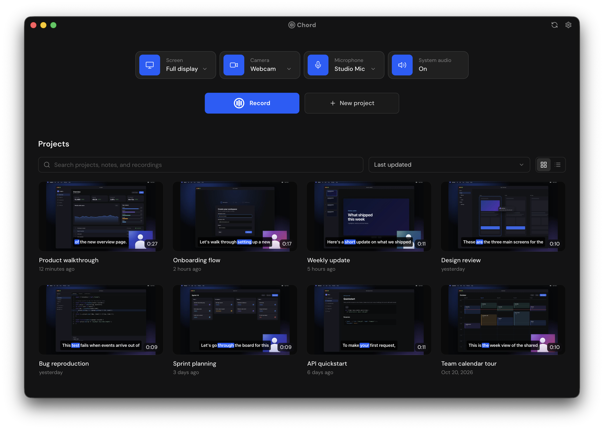
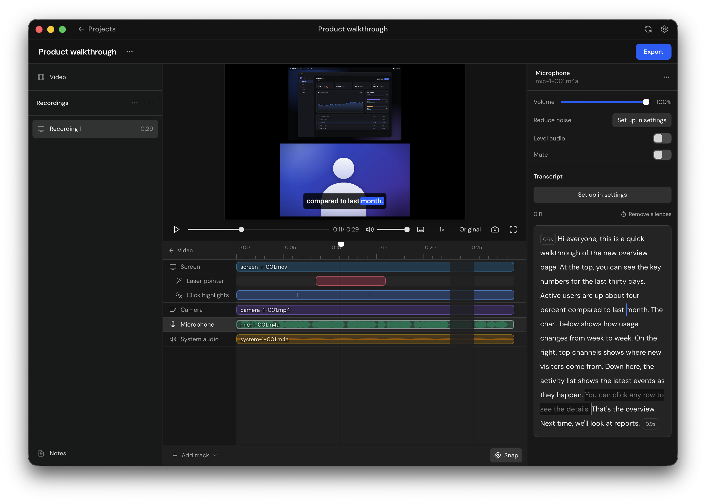
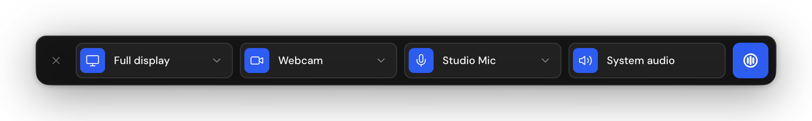
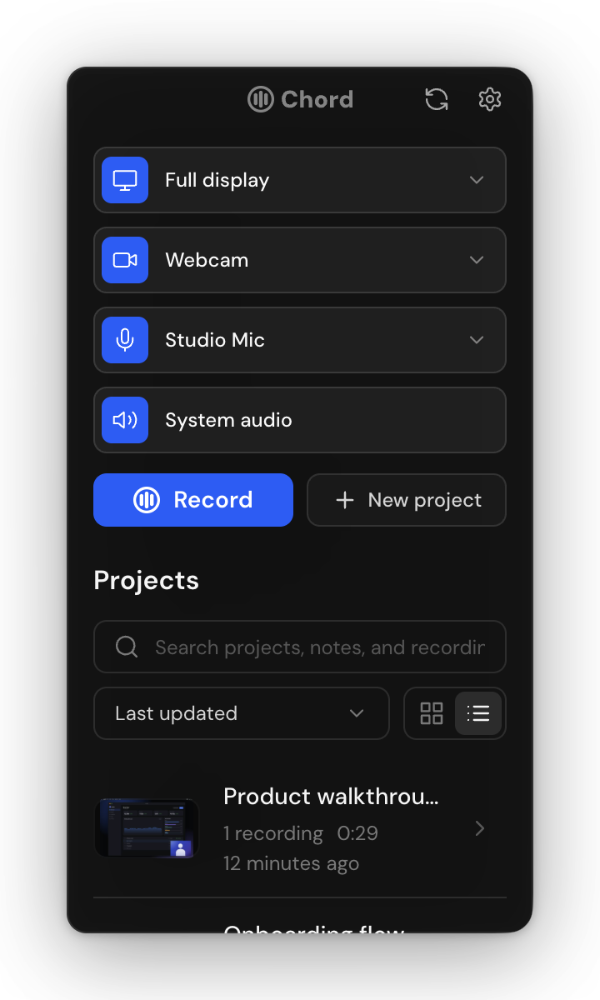

<div align="center">

<picture>
  <source media="(prefers-color-scheme: dark)" srcset="docs/images/logo-dark.svg">
  
</picture>

<h3>Easy device recording for quick and professional use cases.</h3>

<p>
  <a href="LICENSE"></a>
  
  
  
  
  
</p>

<p>
  <a href="#features">Features</a>&nbsp;&nbsp;&nbsp;&nbsp;
  <a href="#status-and-support">Status</a>&nbsp;&nbsp;&nbsp;&nbsp;
  <a href="#building-from-source">Build from source</a>&nbsp;&nbsp;&nbsp;&nbsp;
  <a href="#contributing">Contributing</a>&nbsp;&nbsp;&nbsp;&nbsp;
  <a href="#license">License</a>
</p>

</div>

Chord is a local-first app for recording your screen, camera, microphone and system audio, each on its own track. Everything you record stays fully editable, and you can export it in whichever format you need. Your recordings are stored as ordinary files on your computer, so you can also bring them straight into other editing software.

<p align="center">
  
</p>

## Features

- **Capture:** record a display, a window or an area, along with your camera, microphone and system audio. Start from the app, the menu bar or a keyboard shortcut, and hide apps, the cursor, or the Dock and menu bar while you record.
- **Editing:** arrange recordings as clips on a timeline, then split, trim and move them. Give each clip its own layout, from a single feed to picture in picture and split screens. Cut a recording by selecting words in its transcript, or remove its silences in one go.
- **Pointer and keyboard effects:** add a laser pointer, click highlights and key presses, each on its own track.
- **Transcription:** transcribe on your Mac with NVIDIA Parakeet or Apple Speech, correct the text, and burn in captions or export them as TXT, SRT and VTT files.
- **Audio cleanup:** reduce background noise with DeepFilterNet3 or Apple's Sound Isolation, and even out voice levels.
- **Camera backgrounds:** remove your camera's background with MODNet or BEN2, then blur it or swap in a color. Your original footage is never changed.
- **Export:** save H.264 MP4, transparent WebM or GIF files, or a single frame as a PNG.

<p align="center">
  
  <br>
  <sub>The editor, with a transcript cut, pointer effect tracks and audio waveforms.</sub>
</p>

### Record from anywhere

Start a recording with the floating toolbar, or from the panel under Chord's menu bar icon.

<p align="center">
  
</p>

<p align="center">
  
</p>

## Status and support

Chord is in early development, so expect rough edges and changes along the way.

- **macOS:** macOS 14 or later, tested on Apple Silicon. A few features need a newer version of macOS, and Intel Macs aren't supported yet.
- **Windows, Linux and mobile:** coming soon.
- **Downloads:** get the Apple Silicon build from [Releases](https://github.com/TeamblocksTechnologies/chord/releases/latest). Each download is attested to the commit it was built from; check one with `gh attestation verify Chord-<version>-arm64.dmg --repo TeamblocksTechnologies/chord`.
- **Help:** if something isn't working, [open an issue](https://github.com/TeamblocksTechnologies/chord/issues).

## Building from source

You'll need:

| Requirement | Version        | Notes                                                               |
| ----------- | -------------- | ------------------------------------------------------------------- |
| macOS       | 14 or later    |                                                                     |
| Xcode       | 26 (Swift 6.3) | Builds the native helpers. The exact version is in `.xcode-version` |
| Node.js     | 24 or later    | Pinned in `.node-version`                                           |
| pnpm        | 12             | `corepack enable` sets up the version pinned in `package.json`      |

Then:

```sh
git clone https://github.com/TeamblocksTechnologies/chord.git
cd chord
corepack enable
pnpm install
native/macos/scripts/build.sh
pnpm dev
```

The first time you record, macOS asks for screen recording, camera and microphone access. When Chord runs from source, the prompt may name your terminal app instead of Chord.

## Development checks

```sh
pnpm format           # Format web files and Swift sources
pnpm format:check     # Check formatting without changing files
pnpm lint             # ESLint for TypeScript, JavaScript and Svelte
pnpm typecheck        # TypeScript, Svelte, test types and architecture boundaries
pnpm test             # Node tests, including the helper contract when the helper is built
swift test --package-path native/macos --force-resolved-versions
pnpm build
pnpm test:integration # After building the app and native helpers; needs ffmpeg
```

See [source organization](docs/architecture.md) for how the code is laid out, [releasing](docs/releasing.md) for how versions ship, and the [desktop app README](apps/desktop/README.md) for integration checks and screenshots.

## Contributing

Chord doesn't currently accept external contributions. You're still welcome to open issues and pull requests, but please note that pull requests will likely not be merged.

## Security

See [SECURITY.md](SECURITY.md) to report a vulnerability.

## About

Chord is built by [Teamblocks](https://teamblocks.dev). Find more of our work on [GitHub](https://github.com/TeamblocksTechnologies).

## License

Copyright 2026 Teamblocks Technologies Inc.

Chord is licensed under the [GNU Affero General Public License v3.0](LICENSE). Third-party software and models are listed in [THIRD_PARTY_NOTICES.md](THIRD_PARTY_NOTICES.md).
